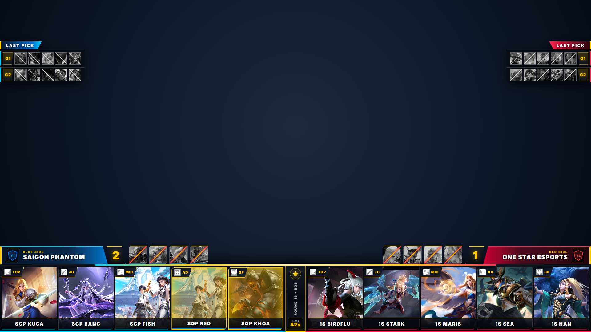
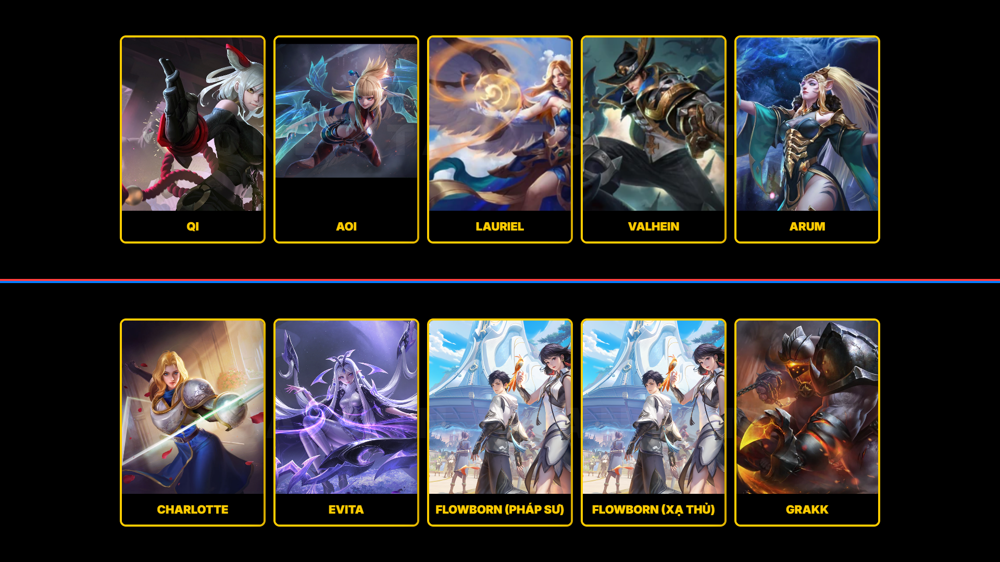
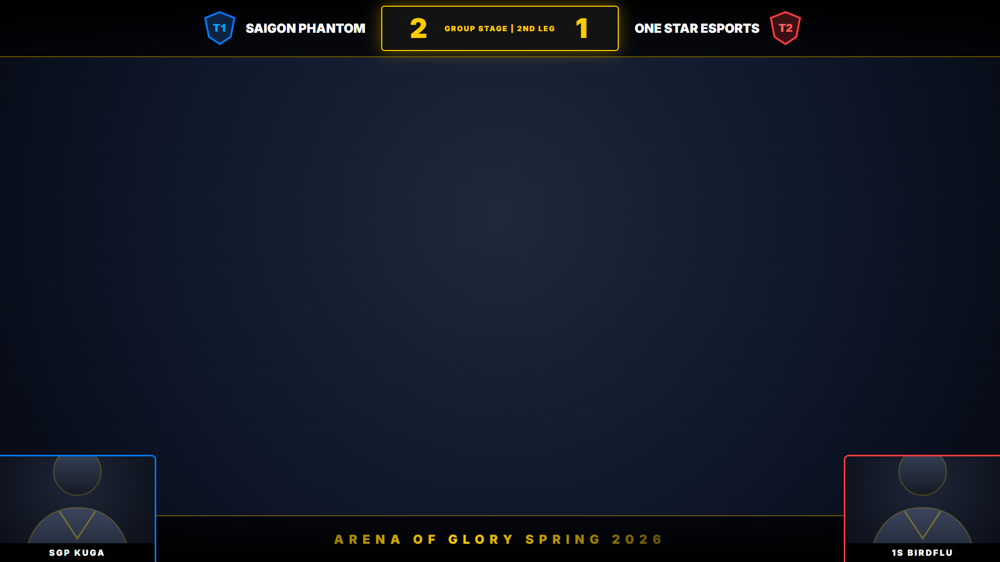
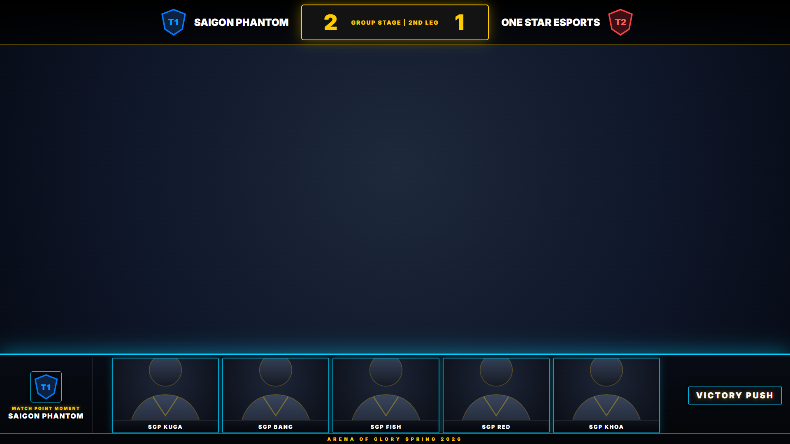
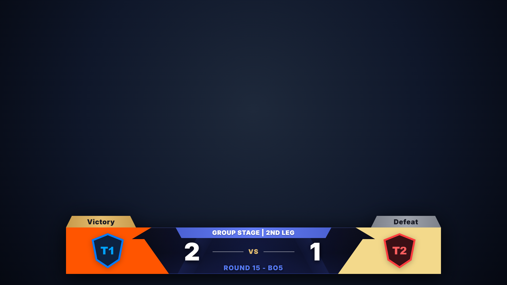
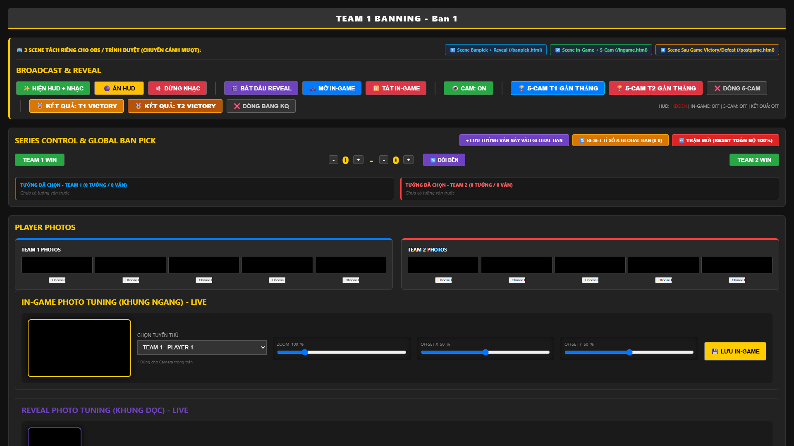

# AOV Ban/Pick Broadcast HUD — Pro Tournament Control

Bộ giao diện phát sóng giải đấu **Liên Quân Mobile (Arena of Valor - AOV)** chuyên nghiệp dành cho OBS / vMix / Livestream, hỗ trợ đầy đủ quy trình từ **Ban/Pick (Global Ban Pick)**, **Lật thẻ bài (Reveal)**, **In-Game HUD (kèm 5-Cam Gần Thắng)** cho đến **Bảng Kết Quả Sau Trận (Victory / Defeat Banner)**.

---

## 📸 Hình ảnh Giao diện (Screenshots)

### 1. Scene 1: Giao diện Cấm Chọn (Ban/Pick HUD & Global Ban Pick)
> File: `banpick.html` (hoặc `index.html`) — Hỗ trợ bộ đếm 60fps mượt mà, hiệu ứng nháy lượt cấm/chọn và bảng tướng đã chọn các ván trước (`LAST PICK`).



### 2. Scene 1: Hiệu ứng Lật Thẻ Bài (Team & Hero Reveal)
> Hiệu ứng trượt 2 hàng thẻ bài tuyển thủ và lật sang tướng đã khóa trước khi vào trận.



### 3. Scene 2: Giao diện Trong Trận (In-Game Overlay)
> File: `ingame.html` — Thanh tỉ số phía trên và 2 khung Camera tuyển thủ luân phiên ở 2 góc dưới.



### 4. Scene 2: Khung 5-Cam Gần Thắng (Victory Push 5-Cam)
> Hiển thị đồng loạt 5 khung Camera của đội đang đẩy nhà chính / chuẩn bị chiến thắng ngay trong `ingame.html`.



### 5. Scene 3: Khung Thông Báo Kết Quả Sau Trận (Post-Match Victory / Defeat)
> File: `postgame.html` — Khung thông báo đội thắng cuộc kèm nhạc nền chiến thắng tự động phát từ đầu và tự động cộng tỉ số.



### 6. Bảng Điều Khiển Đạo Diễn (Admin Control Panel)
> File: `admin.html` — Trung tâm điều khiển toàn bộ giải đấu theo thời gian thực.



---

## 🎬 Cấu trúc 3 Scene Tách Riêng (Chuyển cảnh mượt trên OBS / vMix)

Để chuyển cảnh trên OBS không bị khựng, bộ HUD được tách thành **3 file HTML độc lập** (có thể thêm bằng đường dẫn `http://localhost:3000/...` hoặc tick chọn **Local file** trong OBS Browser Source, kích thước `1920x1080`):

| Scene | File / Đường dẫn URL | Chức năng chính |
| :--- | :--- | :--- |
| **Scene 1: Banpick + Reveal** | `banpick.html` (`http://localhost:3000/banpick.html`) | Hiển thị khung Cấm/Chọn, Global Ban Pick (`LAST PICK`), nhạc nền Banpick (`music/banpick.mp3`) và hiệu ứng lật 10 thẻ bài (`🎬 BẮT ĐẦU REVEAL`). |
| **Scene 2: In-Game + 5-Cam** | `ingame.html` (`http://localhost:3000/ingame.html`) | Hiển thị thanh tỉ số đỉnh màn hình, 2 khung Cam tuyển thủ ở góc và thanh **5-Cam Gần Thắng** (`🏆 5-CAM T1/T2 GẦN THẮNG`). |
| **Scene 3: Sau Game (Kết Quả)** | `postgame.html` (`http://localhost:3000/postgame.html`) | Hiển thị bảng kết quả **Victory / Defeat** chuẩn giải đấu kèm nhạc nền chiến thắng sau trận. |
| **Bảng Điều Khiển (Admin)** | `admin.html` (`http://localhost:3000/admin.html`) | Trang điều khiển dành cho trọng tài / đạo diễn hình ảnh. |

---

## 🚀 Hướng dẫn Sử dụng

### 1. Khởi động Server đồng bộ
Mở Terminal / PowerShell trong thư mục dự án và chạy:
```bash
node server.js
```
*(Hoặc nhấp đúp vào file `START_HUD.bat` trên Windows).*  
Server sẽ chạy tại `http://localhost:3000/` để đồng bộ trạng thái tức thời giữa `admin.html` và các Scene trên OBS.

### 2. Thiết lập trên OBS Studio
1. Tạo 3 **Browser Source** (kích thước `1920 x 1080`) tương ứng với 3 cảnh:
   - **Banpick & Reveal**: `http://localhost:3000/banpick.html`
   - **In-Game HUD**: `http://localhost:3000/ingame.html`
   - **Post-Game Result**: `http://localhost:3000/postgame.html`
2. Bật tùy chọn **Control audio via OBS** nếu muốn điều chỉnh âm lượng nhạc Banpick và nhạc Chiến thắng ngay trên OBS Audio Mixer.

### 3. Điều khiển trên `admin.html`
- **Team & Series Setup**: Nhập tên 2 đội, chọn màu chủ đạo cánh đội (hiển thị trên bảng Victory/Defeat), tải lên Logo đội và ảnh 10 tuyển thủ.
- **Broadcast & Reveal**:
  - `✨ HIỆN HUD + NHẠC` / `🌑 ẨN HUD` / `🔇 DỪNG NHẠC`: Điều khiển khung Banpick và phát lại nhạc nền từ giây `0`.
  - `🎬 BẮT ĐẦU REVEAL`: Chạy hiệu ứng lật thẻ bài tuyển thủ sang tướng.
  - `🏆 5-CAM T1/T2 GẦN THẮNG` / `❌ ĐÓNG 5-CAM`: Bật/tắt thanh 5 camera tuyển thủ trong `ingame.html`.
  - `🏅 KẾT QUẢ: T1/T2 VICTORY` / `❌ ĐÓNG BẢNG KQ`: Tự động cộng `+1` điểm cho đội thắng, hiển thị bảng kết quả Victory/Defeat và phát nhạc chiến thắng từ đầu.
- **Global Ban Pick**: Tự động khóa các tướng đã được từng đội sử dụng ở những ván trước trong cùng loạt trận BO3 / BO5 / BO7.
- **Hero & Player Photo Tuning**: Căn chỉnh `Zoom`, `Offset X`, `Offset Y` trực tiếp cho từng ảnh tướng (lưu vĩnh viễn vào `hero_offsets.json`) và ảnh tuyển thủ.
